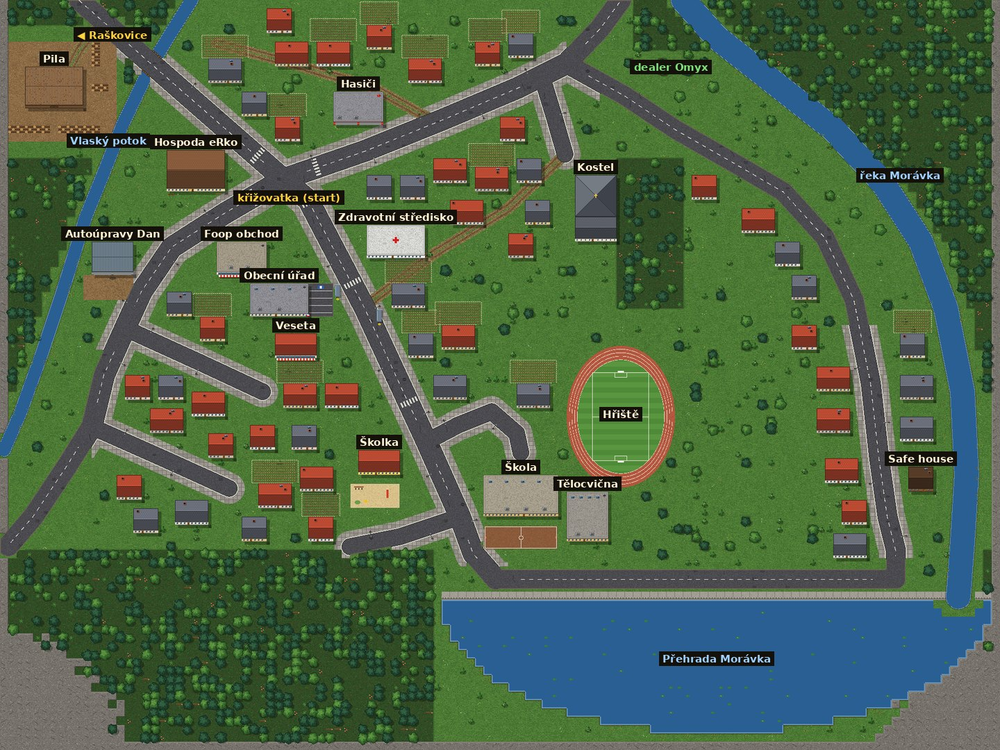

# Mapa Morávky

Morávka je postavená podle skutečné vesnice (ne na 100 %): hospoda eRko a škola jsou tam, kde
mají být, ostatní je přizpůsobené hře. Mapa je v `src/world/realMoravka.ts`, Raškovice jsou
generované údolí (`src/world/moravka.ts`).

## Místa

| Místo | Co tam je |
|---|---|
| Hospoda eRko | Křižovatka uprostřed; dveře dole. Vlevo parkoviště se stáními a traktorem s vlečkou (ADR-029). Zastávka se Slečnou Kobylou. |
| Hasičská zbrojnice | U návsi, území Hasičů. |
| Náves, obecní úřad | Úřad s parkovištěm a policejním autem. |
| Vesta | Obchod pod pultem u úřadu (a cíl mise s jeřábem). |
| Autoúpravy Dan | Garáž Vysokého Dennyho (vlevo dole od eRka). |
| Škola, hřiště s oválem | Na jihu; Omladina se drží u hřiště. |
| Školka | U školy. |
| Kostel | Východně od návsi; lešení pro Dennyho sochaře. |
| Stará pila | Vlevo nahoře za potokem; ateliér Dennyho sochaře. |
| Omyx | U řeky na severu (přes den). |
| Přehrada a hráz | Na jihu, silnice po koruně hráze. |
| Chata (safe house) | Jihovýchod u řeky. |
| Dům Zjebala a Ajiny | Jihovýchod u řeky. |
| Výjezd na Raškovice | Levý horní roh. |

## Silnice a voda

Silnice a potoky jsou osy (lomené čáry), mřížka dlaždic se z nich promítne. Hlavní smyčka:
jih, hráz, silnice podél řeky Morávky, silnice na Raškovice. Vlaský potok teče na západě,
řeka Morávka na východě.
