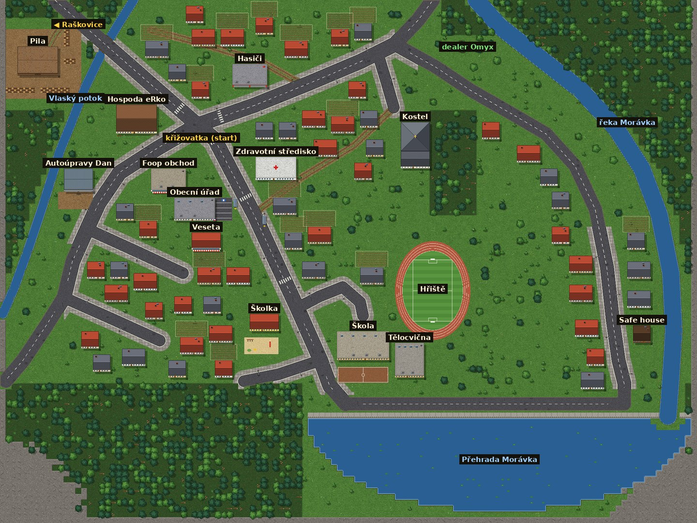

# Grand Theft Morávka: plán vývoje po fázích

> **Historie.** Tohle je původní plán technických fází 0–9 (základ mechanik). Hra pak přešla na příběhovku: plán příběhu je v [docs/hra/PRIBEH.md](../hra/PRIBEH.md), rozhodnutí v [docs/adr/](../adr/README.md), postavy v [docs/hra/POSTAVY.md](../hra/POSTAVY.md).

Hra s pohledem shora (2D) z obce Morávka v Beskydech a jejího okolí. Hráč chodí pěšky, krade a řídí auta, bojuje, plní zakázky pro soupeřící skupiny a utíká policii. Do další oblasti postoupí, když v té současné vydělá dost peněz a nasbírá cílové skóre. Splnit všechny mise k tomu není potřeba.

Každá fáze končí **hratelným stavem**. Hra se tak dá zkoušet po každém kroku a nic se nestaví naslepo.

---

## Technologie (návrh)

| Oblast | Volba | Proč |
|---|---|---|
| Jazyk | TypeScript | Typy ohlídají chyby, až systémů (skupiny, policie, mise) přibude. |
| Herní engine | Phaser 3 | Ověřený 2D engine pro prohlížeč: tilemapy, kamera, fyzika a kolize už v sobě má. |
| Build | Vite | Rychlý vývojový server a jednoduchý build. |
| Mapa | Zatím generovaná kódem, později Tiled (`.tmj`) | Kód se rychle ladí; Tiled přijde pro ruční detaily. |
| Testy | Vitest | Pro herní logiku (respekt, hledanost, skóre) nezávisle na vykreslování. |
| Nasazení | GitHub Pages přes GitHub Actions | Každá verze hratelná v prohlížeči přes odkaz. |

Hra poběží v prohlížeči na PC, ovládání klávesnice + myš. Gamepad a mobil až v pozdější fázi.

---

## Fáze 0: Kostra projektu ✅

- Projekt Vite + TypeScript + Phaser, složky `src/scenes`, `src/systems`, `src/entities`, `assets/`.
- Prázdná scéna, herní smyčka, načítání assetů.
- Lint, formátování, Vitest.
- GitHub Actions: build + testy u každého pushe, nasazení na GitHub Pages.

**Hotovo, když:** hra se otevře v prohlížeči z odkazu na GitHub Pages a CI je zelené.

## Fáze 1: Hráč a svět Morávky ✅

- Hráč pěšky: pohyb WASD, míření myší, chůze a sprint.
- První mapa: střed Morávky, hlavní silnice, řeka Morávka, přehrada, domy, les, kopce jako neprůchozí terén.
  Mapa se zatím generuje kódem (`src/world/moravka.ts`), což se při ladění rozložení upravuje rychleji než v Tiled. Na Tiled přejdeme, až bude potřeba ruční detail.
- Kolize se stěnami, vodou a stromy; les zpomaluje.
- Kamera sleduje hráče, minimapa v rohu.
- Jednoduché placeholder grafiky (barevné tvary), aby šlo hru hrát hned.

**Hotovo, když:** se dá volně procházet celou první mapou a nikde se nejde projít zdí.

## Fáze 2: Vozidla ✅

- Nástup a výstup (klávesa E), krádež zaparkovaného auta i vyhození řidiče.
- Jízdní model shora: zrychlení, brzda, smyk, ruční brzda, rozdílné chování na silnici, šotolině a v trávě.
- Typy vozidel: osobák, dodávka, terénní auto, traktor, policejní auto.
- Poškození vozidel: kouř, oheň, výbuch.
- NPC doprava jezdí po silnicích.

**Hotovo, když:** hráč ukradne auto, projede vesnici, nabourá a auto se dá zničit.

## Fáze 3: Boj a zdraví ✅

- Zbraně: pěsti, pálka, pistole, brokovnice, samopal; střelba ve směru myši, munice.
- Zdraví a vesta hráče, zdraví NPC.
- Chodci reagují: utíkají, volají policii.
- Smrt hráče: probuzení u zdravotního střediska, doktor si vezme 30 % peněz, zbraně propadnou.
- Zbraně, vesta a lékárničky leží na mapě a po minutě se obnoví; mrtví chodci občas upustí peníze.
- Drsní chodci se brání pěstmi; panikařící chodci volají policii (událost `crime`, kterou ve fázi 4 převezme policie).

**Hotovo, když:** jde bojovat pěšky i z auta a smrt má jasný a férový následek.

## Fáze 4: Policie a hledanost ✅

- Trestné činy (krádež auta, napadení, střelba, ničení) zvyšují hledanost.
- 5 úrovní hledanosti:
  1. běžná hlídka,
  2. více policejních vozidel,
  3. zátarasy a intenzivní pronásledování,
  4. ozbrojené jednotky,
  5. kompletní hon na hráče.
- Policie hráče hledá podle toho, kde ho viděla naposledy. Mimo dohled hledanost postupně klesá; úkryt v lese nebo převlečení auta pomáhá.
- Zatčení (na 1.–2. úrovni, když tě policista chytí pěšky nebo v stojícím autě): noc na služebně u obecního úřadu, pokuta 20 % a zbraně pryč.
- Policejní auta hledají cestu po mapě (silnice mají přednost), na 3. úrovni střílí z oken, na 4. přijíždí zásahovka se samopaly.
- Po nahlášení zločinu má policie 10 s na dojezd, teprve pak běží odpočet útěku.
- Hvězdičky hledanosti na HUDu.

**Hotovo, když:** krádež auta spustí honičku, která se umí vyhrotit až na úroveň 5 i zase uklidnit.

## Fáze 5: Skupiny a respekt (hlavní mechanika) ✅

- Data skupin: název, barva/symbol, území na mapě, členové, typická vozidla, vztahy k ostatním skupinám.
- 4 skupiny v první oblasti (viz [Skupiny Morávky](#skupiny-morávky)).
- Respekt u každé skupiny: od -100 do +100, start kolem 0.
  - **Roste:** splněná mise, pomoc členům, škoda nepřátelům skupiny.
  - **Klesá:** zabití členů, zničení majetku, selhání v důležité zakázce.
  - Pomoc jedné skupině automaticky snižuje respekt u jejích nepřátel.
- Chování podle respektu: vysoký respekt znamená, že tě nechají být nebo ti pomůžou; hluboko v mínusu na jejich území zazní „To je on!“ a zaútočí.
- Skupiny reagují i na policii a na sebe navzájem. Tím vzniká řetězový chaos: honička → spřátelená skupina napadne policii → přijedou posily.
- HUD: respekt u skupin v aktuální oblasti.
- Herní čas (den = 12 minut, začíná se v 16:00), noc ztmaví obraz; Štamgasti jsou večer rychlejší, přesnější a házejí molotovy.
- Vozidla skupin (traktory a dodávka Dřevařů, skútry Omladiny a Štamgastů, kola Biomatek): krádež −8, zničení −12 respektu.
- Zatím neřešeno: členové skupin nejezdí vozidly, chodí pěšky.

**Hotovo, když:** se dá situace „ukradnu auto → policie → vjedu ke spřáteleným → oni střílí na policii“ odehrát sama od sebe, bez skriptu.

## Fáze 6: Mise a zakázky ✅ (nahrazeno příběhem)

> Od fáze P1 zakázky ve hře nejsou: nahradil je příběh po aktech ([PRIBEH.md](../hra/PRIBEH.md), ADR-001). Kroky misí, ukazatel cíle a text úkolu v HUDu zůstaly a používá je příběh. Popis níže je historie.

- Místa se zakázkami na mapě (u každé skupiny).
- Obtížnosti podle respektu: 🟢 zelená (vždy), 🟡 žlutá (respekt od cca +30), 🔴 červená (od cca +60).
- Typy misí jako šablony: ukradni vozidlo, doprav člověka, zlikviduj bosse, znič vozidlo, dovez zásilku, přepadni konvoj, sabotuj objekt, ukradni náklad, ochraň člena, uteč policii, přežij útok.
- Komplikace, které se náhodně spustí během mise (majitel volá policii, nepřátelská skupina přepadne, auto se rozbije). Mise se tak nedrží jednoho plánu: „Dovez dodávku z Raškovic“ může skončit honičkou, útěkem do lesa a návratem pro dodávku.
- Odměny: peníze, respekt, skóre.
- Zadavatelé: Dřevaři u pily, Štamgasti u hospody, Biomatky u školky (dřív Ekologové na hrázi), Omladina u školy. Nabídka klávesami 1–3, X zakázku vzdá.
- 13 zakázek (4 Dřevaři, 3 Štamgasti, 3 Biomatky, 3 Omladina) pokrývá všech 11 typů.
- Komplikace: majitel volá policii, přepadení nepřátelskou skupinou, porucha auta, práskač u policie.
- Selhání žluté nebo červené zakázky stojí respekt; smrt nebo zatčení zakázku ukončí.
- Členové skupin a policisté pěšky si hledají cestu kolem domů.

**Hotovo, když:** je v první oblasti aspoň 10 zakázek napříč všemi barvami a skupinami a komplikace se objevují bez ručního skriptování.

## Fáze 7: Skóre, peníze a postup oblastmi ✅

- Skóre za mise, chaos, honičky, styl (dlouhý únik, zničené vozidlo, přežití hledanosti 5).
- Peníze: odměny z misí, kradení, prodej aut; útrata za zbraně, opravy, úkryty.
- Cíl oblasti: dané skóre + peníze. Po splnění se otevře další oblast.
- Návrh oblastí: **Morávka** → **Raškovice** → **Krásná** → **Lysá hora** (každá s vlastními skupinami).
- Ukládání a načítání hry.
- Skóre: zakázky, útěk policii (50 × úroveň²), vraky a řetězové reakce, drift, přežití 30 s na 5 hvězdách, zabití.
- Garáž (oprava, přelakování do 3 hvězd, výkup aut), obchod „pod pultem“ (zbraně, vesta, lékárnička), chata (koupě, uložení, spánek). Od P1 garáž obsluhuje Vysoký Denny rozhovorem a obchod má Vesta.
- Cíl Morávky: 1 500 skóre získaných v Morávce a 2 500 Kč. Raškovice: 3 000 a 6 000 Kč.
- Raškovice mají vlastní údolí (jiné vlnění řeky a silnice, domy, lesy) a místní názvy; respekt a zakázky se počítají pro každou oblast zvlášť.
- Zatím neřešeno: Raškovice používají stejné čtyři skupiny a stejný katalog zakázek jako Morávka; vlastní skupiny a zakázky, Krásná a Lysá hora přijdou ve fázi 8.
- Uložení: automaticky po zakázce, splnění cíle a přejezdu do jiné oblasti; ručně v chatě. Na úvodní obrazovce C = pokračovat.

**Hotovo, když:** jde splnit cíl Morávky a přejít do Raškovic s uloženým postupem.

## Fáze 8: Obsah a vyladění ✅

- Vlastní grafika místo placeholderů (budovy, auta, postavy v pixel-artu).
- Zvuky a hudba, rádio v autě.
- Hlavní menu, nastavení, tutoriál.
- Vyvážení obtížnosti, výkon, oprava chyb.
- Volitelně: gamepad, mobilní ovládání.

Hotovo:
- Raškovice: místní skupiny (Voraři, Rybáři, Chalupáři, Učňáci) se stejným chováním jako v Morávce a 9 vlastních zakázek.
- Zvuk generovaný v prohlížeči (WebAudio, žádné soubory): střelba, výbuchy, rány, sklo, troubení, motor podle rychlosti, policejní siréna, znělky zakázek.
- Rádio v autě (R): Rádio Beskydy Punk, Dechovka U Kapra, Rádio Ekobalada, nebo vypnuto.
- Hlavní menu, nastavení (hlasitosti, tutoriál), přehled ovládání, pauza (Esc).
- Tutoriál pro novou hru (H skryje).
- Noc ve světě, reflektory aut, stíny budov a komíny.

Zbývá do budoucna:
- Grafika je pixel-art kreslený kódem po pixelech (src/art): malovaná mapa, sprity aut a postav s animací chůze, stopy na zemi, noční světla. Další krok by byl ručně kreslený tileset v editoru.
- Krásná a Lysá hora.
- Členové skupin za volantem, gamepad a ovládání na mobilu.

**Hotovo, když:** se dá hra pustit někomu cizímu a zvládne ji bez vysvětlování.

## Fáze 9: Živá vesnice ✅

Z dokumentu Game Update 1 jen to, co má největší přínos a jde udělat bez přestavby mapy. Zbytek je v [TODO.md](../../TODO.md).

- **Svědci a popis:** zločin zvedne hledanost, jen když ho vidí policie, nebo ho nahlásí svědek. Svědek telefonuje 5–10 s (hovor jde přerušit: zastrašit zbraní, zranit ho). Popis se může plést (barva, typ auta); policie hráče pozná podle popisu, zblízka vždy. Na HUDu je „Hledají: …“. Skupiny už policii nevolají samy, jdou přes stejné svědky (spojenci mlčí, nepřátelé volají rádi).
- **Omezený počet policistů:** dvě hlídky na obchůzce, posily přijíždějí z okrajů mapy, policisté se po akci vracejí na stanici a doplňují se.
- **Policie proti NPC:** nehoda, ujetí od nehody, rvačka, sražený chodec, opilec za volantem. Nejbližší volná hlídka vyjede, dojede podezřelého a zatkne ho. Hráč od 2 hvězdiček má přednost.
- **Nehody v provozu:** řidiči mají povahu (normální, spěchající, s mobilem, večer opilý) a reakční dobu. Po nárazu vystoupí, hádají se, pak se usmíří, poperou, nebo jeden ujede. Když hráč nabourá auto a ujede, poškozený volá policii.
- **Divočáci** přebíhají silnici. Řidiči brzdí, auto do divočáka narazí, omráčené prase někdo nahlásí a policie ho zadrží.
- **Obecní rozhlas a rádio v autě** hlásí skutečné události (nehoda, divočák, opilec, pátrání po hráči, honička hlídky) a mezi tím obecní hlášení.
- **Deník událostí** s příčinami (divočák → brzda → nehoda → hádka → útěk → svědek → hlídka → zatčení). F9 ukáže řetězce v ladicím překryvu.
- Provoz se nezasekne: zácpu do kruhu vyřeší přednost, kolem vraku se auto protáhne krokem, na konci trasy auto odjede z vesnice. Vraky, zabavená a opuštěná auta odtáhne odtahovka, když se hráč nedívá; parkoviště se zase zaplní.
- Výbuch auta po nehodě v provozu už není hráčův zločin.

Dlouhý běh: `npm run build && npm run soak` přehraje 30 minut herního času bez hráče (zrychleně, asi 2 minuty) a spočítá řetězce, které spojí aspoň 3 systémy bez hráče. Poslední běh: 74 řetězců, provoz celou dobu jezdí, žádné vraky navíc.

**Hotovo, když:** za 30 minut bez hráče vznikne aspoň jeden řetězec přes 3 systémy a policie, svědci a provoz spolu viditelně souvisí.

## Mapa Morávky podle skutečné vesnice ✅

- Rozložení podle mapy obce (ne na sto procent): křižovatka u **hospody eRko** (hospoda stojí hned západně od ní), silnice na severozápad, na Raškovice (severovýchod), na jihozápad a na jih ke **škole** s hřištěm a oválem.
- Vlaský potok na západě (most na silnici na severozápad), řeka Morávka na severovýchodě a východě, podél ní silnice s cyklostezkou až k hrázi přehrady. Vznikla smyčka: na jih → po hrázi → podél řeky → zpátky na silnici na Raškovice.
- Na místech podle mapy: Hasiči, Foop obchod, obecní úřad s parkovištěm a zastávkou, Vesta (prodává „pod pultem“; dřív Veseta), Autoúpravy Dan (garáž, před ní Vysoký Denny), Školka s pískovištěm, dealer Omyx u řeky, safe house (chata, úkryt) na jihovýchodě, stará pila za potokem (od P2 ateliér Dennyho sochaře).
- Silnice a potoky se kreslí hladce i šikmo podle os (asfalt, chodníky s obrubníky, středové čáry, přechody, mosty se zábradlím, polní cesty s kolejemi). Hra dál počítá s dlaždicemi.
- Mapu staví `src/world/realMoravka.ts` (souřadnice z mapy obce, 16 px mapy na dlaždici); Raškovice zůstávají generované.

### Úpravy po mapě ✅

- Výjezd na Raškovice je v levém horním rohu (silnice na severozápad); konvoj od Raškovic jede odtud.
- Skupiny se přejmenovaly: **Škola → Omladina**, **Ekologové → Biomatky** (v Raškovicích dál Učňáci a Chalupáři). Biomatky se drží u školky, Štamgasti u hospody, Dřevaři na pile, Omladina u školy.
- Členové stejné party spolu kecají v bublinách: Omladina zkratkami generace Z (bruh, no cap, fr fr, yk…), Štamgasti hospodské řeči (Metějka, panáky, kdy se Omyx pomlátí), Dřevaři o stromech, kubících, rumu a Lakatošovi, Biomatky o školní jídelně, chia semínkách a bioleji.
- **Dealer Omyx** stojí u řeky a prodává trávu (150 Kč): minuta klidu, obraz zezelená a lehce se houpe, chodíš pomaleji, ale dech nedochází a pomalu se hojíš. Když ho někdo zabije, za tři minuty je zpátky.
- Postavy se nezasekávají o stromy: chůze počítá s šířkou těla, kdo se zasekne, udělá krok stranou a naplánuje cestu znovu. Chodci se rodí a chodí po chodnících kolem silnic, utíkají na místo, kam se dá doběhnout. Měřeno: zaseknutí při chůzi z 86 % na 2 %, na chodnících a silnicích 75 % chodců (dřív 2 %).

---

## Styl hry

- **Grafika:** rastrový pixel-art (dlaždice 16×16 px, zvětšené bez vyhlazování).
- **Jazyk:** čeština (všechny texty v jednom souboru, aby šlo později přidat další jazyk).
- **Tón:** černý humor, nadsázka, trochu punk. Hlášky chodců a skupin, absurdní komplikace v misích, policejní vysílačka s komentáři.

## Skupiny Morávky

Všechny skupiny jsou smyšlené.

Od fáze P2 jsou skupiny tři (ADR-016, ADR-017): Dřevaři se změnili na Hasiče, Biomatky ze hry zmizely.

| Skupina | Povaha | Kde je najdeš | Zbraně | Vozidla |
|---|---|---|---|---|
| **Hasiči** (dřív Dřevaři) | SDH Morávka: bál, požární útok, pivo ve zbrojnici | Hasičská zbrojnice u návsi | Hasičské sekery | Dodávka u zbrojnice |
| **Štamgasti** | Opilci s velkým srdcem a krátkým fitilem | Hospoda (od rána do noci) | Láhve, molotovy, stará brokovnice | Rozbitá stará auta, mopedy |
| **Omladina** (dřív Škola) | Mladí po maturitě (ADR-018), mluví zkratkami generace Z | Hřiště s oválem za školou | Pálky, nože, petardy | Skútry, kradená auta |

### Vztahy mezi skupinami (výchozí)

| | Hasiči | Štamgasti | Omladina |
|---|---|---|---|
| **Hasiči** | — | 🙂 pijou spolu v eRku | 😠 rivalové (petardy v popelnicích) |
| **Štamgasti** | 🙂 | — | 😠 rivalové (kradou jim pivo) |
| **Omladina** | 😠 | 😠 | — |

### Zvláštní chování

- **Štamgasti** jsou přes den pomalí a nepřesní, večer agresivnější.
- **Hasiči** vydrží nejvíc a bijí sekerou.
- **Omladina** je rychlá, útočí ve skupinkách a rychle utíká.
